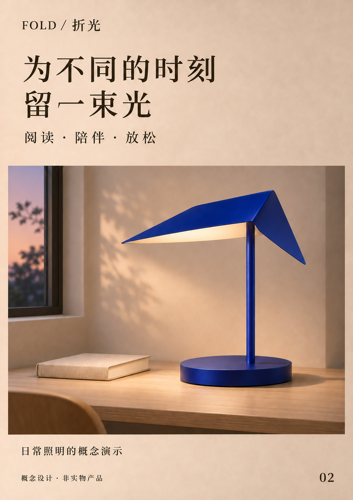
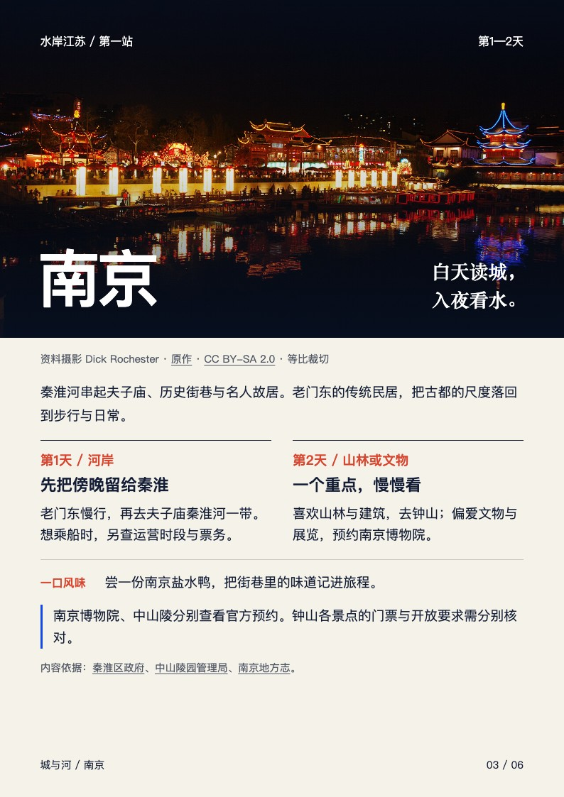

# ai-design

结合生图与图像编辑能力的静态平面设计 Skill：制作海报、封面、宣传图，也支持 **HTML 排版版／生图视觉版**产品手册。

从内容中形成可见的设计概念，再完成构图、字图关系与细节。方向开放时先做关键画面对照，让概念进入封面和真实内容页；以实际成品修订，而不把技术检查通过当作设计质量通过。仓库原名 `product-brochure-designer`；skill 调用名与内层目录暂时保留以兼容已有安装。可用于具备相应工具的 Codex、Claude Code 等 Agent 环境。

## 两类任务，两种制作方式

| 任务 | 生图设计 | HTML 排版 |
|---|---|---|
| 海报、封面、宣传图、Banner | 可以直接完成整张设计，并用图像编辑做局部修改 | 适合精确文字、品牌与改版要求，也可以组合生成素材 |
| 产品手册、宣传册、项目目录 | 统一产品和视觉依据，逐页生成、校对并汇总 PDF | 编辑内容、规划页面，HTML 母版渲染为 PDF；支持有限的可编辑 PPTX 转换 |

生图不局限于生成背景。手册根据视觉表达、内容密度、编辑要求及用户选择走对应路线；不把所有任务强制变成 A4 或同一种杂志风格。首批集中在单页设计和手册，系列图文等后续通过真实任务再扩展。

## 已跑通的示例

[折光 FOLD 生图样册](product-brochure-designer/examples/fold-concept/prompts.md)：两页整体生图，第二页参考第一页延续产品与风格，并用局部编辑修正图注。概念产品明确标注为非实物；保存原图与提示词，可复现 PDF 合页。

 

[水岸江苏 HTML 样册](product-brochure-designer/examples/jiangsu-waterways/brochure.html) · [六页 PDF](product-brochure-designer/examples/jiangsu-waterways/brochure.pdf) · [视觉方向对照](product-brochure-designer/examples/jiangsu-waterways/design/directions.html)：调研南京—扬州—苏州六日路线后，试做“水线版画”和“园窗取景”两种方向的封面与行程页。当前以水线版画扩展全册，组合概念插画、实景摄影与可修改文字。正文打印14pt、手机18px；下载该目录即可打开 HTML。[内容来源与素材说明](product-brochure-designer/examples/jiangsu-waterways/sources.md)。

 

其他示例：

- [开放工作室](product-brochure-designer/examples/open-studio/)：同一虚构活动的竖版 1080×1440、横版 1920×1080 HTML 排版，展示跨尺寸重排。
- [研学手册旧稿](product-brochure-designer/examples/sustech-study-tour/)：原有 10 页草稿，含待确认内容和图像占位，保留作机制参考；新 HTML 手册以大字和响应式阅读为默认方向。

示例与一次试跑不能证明任意任务都能稳定达到同样质量。范围判断和基线问题见 [调研](docs/research/2026-11-16-设计Skill范围调研.md)，本轮实施与验证见 [PROGRESS.md](PROGRESS.md)。

其他同类项目及可借鉴做法见 [同类项目对照](docs/research/2026-11-16-同类项目对照.md)。

## 安装与使用

真正的 skill 是仓库内的 **`product-brochure-designer/` 子目录**，其根部有 `SKILL.md`。把该子目录放到目标项目的 `.agents/skills/` 或 `.claude/skills/` 等宿主支持的位置；不要把仓库根目录当作 skill，也无需全局安装。

Agent 从 [SKILL.md](product-brochure-designer/SKILL.md) 开始：

1. 理解用途、读者、准确内容、素材、尺寸与交付格式。
2. 选择单页／手册，并确定生图或 HTML 路线。
3. 按任务读取相应参考，以视觉概念和关键页确定方向，再展开、查看和精修。
4. 查看实际 PNG／PDF，核对内容、产品、字体、裁切与尺寸，再交付。

可直接请求：

```text
用 $product-brochure-designer 为这个活动做一张生图海报，日期和标题严格按我的文案。
用 $product-brochure-designer 做一份生图版产品手册，保持每页的产品外观与视觉风格一致。
用 $product-brochure-designer 把这些资料做成 HTML 产品手册，保留精确参数和可修改文字。
```

## 脚本

以下命令在 **skill 子目录**运行：

```bash
git clone https://github.com/haoabcde/ai-design.git
cd ai-design/product-brochure-designer
node scripts/smoke.mjs
node --test tests/*.test.mjs
```

HTML 路线的 JSON 输入和核心脚本不需要 npm 依赖：

```bash
node scripts/image-workflow.mjs analyze --product product.json
node scripts/image-workflow.mjs source-plan --product product.json
node scripts/image-workflow.mjs manifest --download-dir downloads --output images.json
node scripts/check.mjs --html design.html --images images.json
# 产品手册可再传 --product product.json；草稿可加 --mode draft
```

- 清单路径相对 `images.json`；HTML 图片路径相对 HTML。清单初始待审核，不覆盖已有审核记录。
- 客户素材、官方来源、授权图库与说明性生成图分别记录使用依据。公开发布不自动代表获准使用。
- 检查器核对静态 HTML、实际素材引用、模板占位、待确认内容和部分文案线索。它不测量布局，也不能证明事实或授权成立；生图结果与最终导出仍需目检。
- JSON Schema 用于输入编辑与外部校验；脚本仅执行文档所述的行为检查，不是完整 Schema 校验器。

生图版手册可以使用宿主 PDF 工具，或这个可选 Python 合页脚本：

```bash
# Python 环境需要 reportlab
python3 scripts/images-to-pdf.py --images page-01.png page-02.png --output booklet.pdf
# 多页续作：使用清单记录页序、提示词和参考关系，导出时核对文件与目检状态
python3 scripts/images-to-pdf.py --manifest examples/fold-concept/booklet.json --output output/fold-concept-reviewed.pdf
```

按参数页序合页，默认 A4，完整等比放置；比例不同处留白。报告原图像素与有效 ppi，不改写图像内容。`--page-size native` 使用首图的 96dpi 尺寸建立统一画幅。

清单模式按 `pages` 数组顺序合页，路径相对清单文件。图片、完整提示词和参考文件需要齐全，每页经实际查看后标记 `reviewed`；检查状态由 Agent 更新，不增加用户确认步骤。未通过的页会阻止导出，防止遗漏页面或混入未检查的草稿。Python 测试可运行 `python3 -m unittest discover -s tests -p 'test_*.py'`；PDF 集成测试另需 reportlab、pypdf。

可选的 HTML → PPTX 与 YAML 输入依赖：

```bash
pnpm install --frozen-lockfile
node scripts/html-to-pptx.mjs --html brochure.html --output brochure.pptx
```

PPTX 仅支持六类语义版式，是可编辑近似稿。自定义页面会停止并报错，避免静默输出缺页文件；整页生图不会自动变成可编辑文字。

## 目录

```text
product-brochure-designer/
├── SKILL.md
├── agents/openai.yaml
├── references/
│   ├── design-system.md       # 共享设计判断
│   ├── art-direction.md       # 视觉发想、关键页比较与审美反馈
│   ├── image-generation.md    # 整图／整页生图、编辑、多页一致性
│   ├── single-page.md         # 单页与跨尺寸设计
│   ├── brochure.md            # 手册两种路线及 HTML 机制
│   └── ...                   # 风格、素材、事实、运行说明
├── templates/                # 单页像素画布／A4 HTML 机制
├── scripts/                  # 检查、素材清单、PDF 合页、有限 PPTX 转换
├── schemas/
├── tests/
└── examples/
```

核心脚本需要 Node.js ≥20；生图与原生设计路线依赖宿主实际工具。Python PDF 合页、PPTX 与 YAML 支持均为可选。

[MIT License](LICENSE)。江苏样册所用第三方摄影另按各自 CC 许可使用，见其图注与 [图片署名](product-brochure-designer/examples/jiangsu-waterways/sources.md)。
